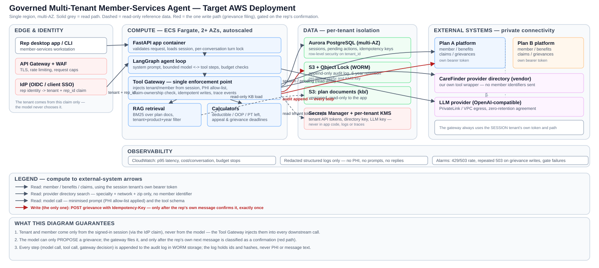

# Design document: Governed multi-tenant member-services agent

Architecture diagram: [docs/architecture.svg](docs/architecture.svg). Implementation detail and the full list of findings/risks behind this document are in [SPEC.md](SPEC.md); this document is the production-facing summary.

## 1. Context and non-functional requirements

Two health-plan clients (`plan_a`, `plan_b`) share one platform. A rep asks the assistant about one member's benefits and claims, or files a grievance after confirming it. The client statement of work sets nine requirements:

| Id | Requirement | How the design responds |
|---|---|---|
| NFR-1 | 99.99% monthly availability | Multi-AZ, stateless autoscaled compute, managed multi-AZ database. See §6: single-region 99.99% is optimistic — treat as a target, not a guarantee. |
| NFR-2 | Single region, lowest run cost | No multi-region spend; serverless/managed compute and database sized to load, scaled to zero where possible. |
| NFR-3 | p95 < 3 s per rep question | §6: not met today with the development model (p95 ≈ 13 s, measured in `reports/eval_report.md`). Architecture keeps every hop short (one DB round trip, direct API calls, no queueing) so the gap is closed by model/prompt work, not infrastructure. |
| NFR-4 | Tenant isolation everywhere (prompts, retrieval, caches, logs) | Enforced in code, not configuration: tenant comes only from the authenticated session; every store, cache key and log line is tenant-prefixed; see Threat model §4 and ADR-1. |
| NFR-5 | PHI minimum-necessary; 6-year audit trail | Allow-list projection to the model (ADR-3); append-only, WORM-backed audit log. |
| NFR-6 | Grievance filed only after confirmation, exactly once | Gateway-owned confirmation state machine and idempotency key (ADR-2). |
| NFR-7 | ≤ $0.03/conversation at 20,000 conversations/day | §2 cost estimate: well under budget on both model and infrastructure cost. |
| NFR-8 | Plan B may need its own tenancy on a different cloud from year 2 | §3; the app is stateless and config-driven per tenant, so a tenant's whole stack (not just the model) can be stood up independently. |
| NFR-9 | 250 concurrent reps at Monday peak | Autoscaled compute, connection pooling, and the claims platform's own rate limit respected (bounded retries, never queued indefinitely). |

## 2. Target production deployment — AWS

**Edge and identity.** Reps authenticate through the client's existing IdP (OIDC) in front of API Gateway + WAF (TLS termination, rate limiting, request-size caps). The IdP token's claims carry the rep's tenant and id; **the application never accepts a tenant from the request body for routing or data access** — it is read once from the verified identity and threaded through the whole request (this is ADR-1).

**Compute.** The FastAPI app runs as stateless ECS Fargate tasks across 2+ AZs, autoscaled on request rate and CPU, scaled down outside business hours (NFR-2). Each task holds no session state between requests — session, pending actions and idempotency records live in the database — so a task can be replaced or added without coordination. The LangGraph agent loop and the tool gateway run in the same process (one network hop saved per tool call); the gateway is the only code path that reaches a downstream system, so it is the one place tenant isolation, PHI rules and budgets are enforced (ADR-1).

**Data,** one store per concern, each tenant-scoped:
- **Aurora PostgreSQL (Multi-AZ)** replaces the POC's JSON files for sessions, pending grievance actions and idempotency keys. A `tenant_id` column with row-level security policies is the production equivalent of the POC's tenant-named folders, and a unique constraint on `(tenant_id, member_id, idempotency_key)` gives the exactly-once guarantee across instances that a single-process file lock cannot (ADR-4).
- **S3 with Object Lock (WORM), per-tenant prefix and KMS key** holds the 6-year audit trail (NFR-5). Nothing is ever deleted or edited; retention is enforced by the bucket, not application code.
- **S3** also holds the plan documents (`kb/`), versioned, loaded read-only by the app; replacing BM25 with a managed vector index (OpenSearch Serverless) is a drop-in change behind the same retrieval interface if the corpus grows past what keyword search handles well.
- **Secrets Manager**, read at task start and cached in memory only, holds the per-tenant API tokens, the directory vendor key and the LLM key. **Per-tenant KMS keys** encrypt that tenant's secrets and S3 objects, so a key compromise or a legal hold for one client does not touch the other's data.

**External systems.** The client's member/benefits/claims platform and the third-party provider directory are reached over private connectivity (PrivateLink/VPN) where the client's network allows it; the gateway always selects the token and URL for the **session's** tenant, never a value the model supplies. The LLM provider is called over a private egress path under a data-processing agreement with a zero-retention clause — the prompt it receives is already PHI-minimised, but this is a contractual control, not one code can enforce.

**Observability.** CloudWatch carries metrics (p95 latency, cost per conversation, budget-stop counts) and structured logs that are redacted before they are written — no prompts, no replies, no PHI, the same redaction used for the trace (Step 9). Alarms watch the claims platform's 429 rate, repeated 503s on grievance writes (the mock's save-then-503 trap, F-20), and evaluation-gate failures in CI.

**Cost at NFR-7's scale (20,000 conversations/day ≈ 600,000/month).** Measured model cost on the development model (`gpt-6-luna`, $0.10/$0.50 per million input/output tokens) is **$0.00059 per conversation** (`reports/eval_report.md`), about $0.35/day at that volume. A rough infrastructure estimate — Fargate autoscaled 4–20 tasks (~$800–1,500/month), Aurora Multi-AZ at a small instance size (~$300–500/month), S3/KMS/NAT (~$100–200/month) — is **$1,200–2,200/month**, or **$0.002–0.004 per conversation**. Combined, total cost is comfortably under the $0.03 ceiling; the headroom is useful because a production-grade model will likely cost more per token than the development one.

## 3. One-page mapping to a second cloud — GCP

NFR-8 is per-tenant, not platform-wide: Plan B may need its **own tenancy** on another cloud, while Plan A stays on AWS. Because tenant isolation is structural (its own tokens, its own KMS key, no shared mutable state beyond process-local budget counters, which production moves to the database anyway), standing up a second, independent stack for one tenant is a deployment exercise, not a redesign.

| AWS service | GCP equivalent | What changes in the app |
|---|---|---|
| API Gateway + WAF | Cloud Armor + API Gateway / Cloud Endpoints | None — HTTP in front of the same container image. |
| ECS Fargate | Cloud Run (or GKE Autopilot for finer control) | None — the image is already 12-factor (config via environment variables), so it is the same container on either runtime. |
| Aurora PostgreSQL (Multi-AZ) | Cloud SQL for PostgreSQL (regional HA) | Connection string only; the store sits behind `SessionStore`/`IdempotencyStore` interfaces (ADR-4), so the SQL driver is the only code that touches the database directly. |
| S3 + Object Lock | Cloud Storage with Bucket Lock (retention policy) | Object-storage client swap behind the same interface; object keys and retention semantics are equivalent. |
| Secrets Manager | Secret Manager | Secrets-client swap; no secret value changes. |
| KMS (per-tenant keys) | Cloud KMS (per-tenant key rings) | Key references in config only. |
| CloudWatch | Cloud Logging + Cloud Monitoring | Same redaction happens before the log call; only the sink changes. |
| Client IdP (OIDC) | Unchanged — OIDC is cloud-agnostic | None; GCP's Identity Platform can front it if the client wants a managed layer. |
| PrivateLink to the LLM provider | Private Service Connect | Networking configuration only; the LLM adapter already targets an OpenAI-compatible endpoint. |

The one-time cost is operational (a second CI/CD pipeline, a second on-call rotation, cross-cloud secret rotation discipline), not architectural. This is also the practical reason for ADR-4 (a managed, swappable store) and for keeping the LLM behind a provider-agnostic adapter from day one of the POC.

## 4. Threat model

| # | Threat (STRIDE) | Vector | Mitigation | Residual risk |
|---|---|---|---|---|
| 1 | Cross-tenant data leakage (Info. disclosure) | Prompt, retrieval, cache or log mixing plan_a/plan_b data | Tenant read only from the session, never the model or request body; KB chunks filtered by their own front-matter tenant (catches a document misfiled under the wrong tenant's folder, F-23); every store/trace path is tenant-prefixed | The mock API itself accepts any valid token on any tenant's URL path (F-18) — the gateway never relies on this, but the real client platform must enforce it too; defence in depth, not a substitute |
| 2 | Cross-member access inside one tenant (Info. disclosure / Elevation) | A claim lookup endpoint is scoped to the tenant only, not the member (F-6) | The gateway re-checks `claim.member_id == session member`; a foreign claim gets the same "not found" response as a missing one, so existence is never confirmed | Depends on every new tool going through the same ownership check; enforced by code review and the eval's hard-fail checks |
| 3 | Prompt injection (Tampering) | Instructions planted in claim notes, grievance text, plan documents, or the vendor's tool manifest (a real example was found in the supplied claim data, F-15) | Untrusted-data framing in the system prompt; the model has no tool that writes, only one that proposes; a write needs the **rep's own next message**, classified by a fixed rule set, never by model output; the vendor manifest is never loaded as instructions | A sophisticated injection could still bias a factual answer; it cannot cause a write or a leak by itself. Not formally red-teamed beyond the one documented case plus the eval's injection test |
| 4 | PHI exfiltration (Info. disclosure) | SSN/DOB/contact fields reaching the model, logs, or the LLM provider | Field allow-list before anything reaches the model (not redaction-only, ADR-3); output guard blocks SSN/phone/email-shaped replies; saved conversation files and traces are redacted; caller verification compares inside the gateway and returns match/no-match only | Pattern-based scrubbing misses unusual formats and names; the provider still receives minimised clinical content, so a BAA and a zero-retention agreement are required controls outside the code |
| 5 | Duplicate or forged grievance writes (Repudiation / Tampering) | Retry after a timeout, a double-clicked confirm, or a 503 that the downstream system answers *after* saving the record (an actual, confirmed mock behaviour, F-20) | The model cannot write; filing needs a rep confirmation; the idempotency key is derived from the exact confirmed payload and reused byte-for-byte on retry; a per-(tenant, member, key) lock serialises concurrent attempts | The POC's lock and idempotency store are single-process files; production needs the database's unique constraint (ADR-4) for the same guarantee across instances |
| 6 | Secret exposure (Info. disclosure) | Tenant tokens, directory key or LLM key in code, logs or the repository | Environment variables only, `.gitignore`d; never written to logs or traces; Secrets Manager + per-tenant KMS in production | Rotation and least-privilege IAM for the secrets store are operational practices this document assumes but does not build |
| 7 | Vendor (directory) compromise or bad data (Tampering / Spoofing) | A malicious or buggy response from the third-party directory | Our own tool schema and description, never the vendor's; every returned provider is re-checked against the member's own network, specialty and ZIP area before being shown (the real directory ignores some filters when asked loosely, F-21); vendor strings length-capped | A compromised vendor could still return plausible wrong (but in-network) listings; impact is limited to provider search, no PHI or write path involved |
| 8 | Audit log tampering (Repudiation) | Deleting or editing trace/audit records to hide an action | Append-only writes; production target is S3 Object Lock (WORM) with a 6-year retention policy | The POC's local JSONL files have no WORM guarantee — acceptable for a development slice, not for production |
| 9 | Denial of service / cost exhaustion (DoS) | A long-running or looping conversation, or many expensive tool calls | Per-turn and per-conversation budgets on model calls, tool calls, time and cost (Step 9); bounded retries against the claims platform's own rate limit | Budget counters are per-process in the POC; production needs a shared counter (the database, or a cache) so limits hold across autoscaled instances |

## 5. Architecture decision records

**ADR-1: The tool gateway is the single enforcement point; tenant and member are bound to the session, never to model output.**
*Context:* every tool call needs tenant isolation, PHI minimisation, write confirmation and budget checks applied consistently as more tools are added. *Decision:* no tool accepts a tenant or member argument; the gateway is built once per request from the authenticated session and is the only code that builds a downstream URL or picks a token. *Alternatives:* enforcing rules inside each tool — rejected, easy to miss on a new one; a system-prompt instruction — rejected, the real cross-tenant token behaviour found in the mock (F-18) shows this cannot be the only control. *Consequences:* a new tool cannot accidentally skip isolation; every tool is written against the gateway's interface rather than calling an API directly.

**ADR-2: Grievance confirmation is a deterministic state machine in the API layer, keyed by idempotency, not an LLM decision.**
*Context:* NFR-6 needs a write only after explicit confirmation, exactly once, even under retries, a 503 answered after the write already succeeded (observed in the mock, F-20), or a double confirm. *Decision:* the model has a `propose_grievance` tool that only stages a pending action; a rule-based classifier reads the rep's **next** message for confirm/cancel/other; a confirmed write reuses an idempotency key derived from the exact payload, retried byte-identically on failure, under a per-request lock. *Alternatives:* a model-decided "file" tool — rejected, indistinguishable from text an attacker planted in a claim note; an LLM-based classifier — rejected for this slice, harder to test exhaustively and the cost of a false positive is a real write. *Consequences:* an unrecognised phrase falls back to asking again rather than guessing — safe, occasionally one extra turn.

**ADR-3: PHI minimisation is an allow-list projection applied before the model sees data, not redaction of its output.**
*Context:* NFR-5 asks for minimum-necessary PHI to the model and in logs. *Decision:* each tool returns a fixed, reviewed set of fields; SSN, DOB, contact details, provider NPI and free-text notes are dropped at the source. Pattern-based scrubbing and an output guard are a second layer, not the primary control. *Alternatives:* sending the full record and trusting instructions not to repeat sensitive fields — rejected, instructions are not a security boundary; redacting only the final reply — rejected, the data would still reach the model and the provider. *Consequences:* a field not currently allow-listed needs a deliberate code change, which is the intended friction.

**ADR-4: State store is pluggable; JSON files for the POC, a managed relational database for production.**
*Context:* sessions, pending actions and idempotency records need durable, tenant-scoped storage; the task scopes a working slice, and separately asks for portability to a second cloud. *Decision:* define `SessionStore`/`IdempotencyStore` interfaces; implement them as atomic, locked JSON files for the POC, replaced by Aurora/Cloud SQL in production behind the same interface. *Alternatives:* in-memory store — rejected, loses the idempotency record exactly when a retry needs it; a real database from day one — rejected for the POC, slower to iterate locally. *Consequences:* the POC's exactly-once guarantee is single-process only (documented in §6); the production swap is a store-implementation change, not a rewrite — also what makes §3's GCP mapping a configuration exercise.

**ADR-5: Retrieval is metadata-filtered keyword search (BM25), not an embedding/vector index.**
*Context:* the knowledge base is a dozen short Markdown files per tenant with reliable `tenant`/`product_code`/`plan_year` front-matter; retrieval must never cross tenants or plan years. *Decision:* chunk by table row and heading, filter candidates by front-matter before ranking, rank with BM25. *Alternatives:* an embedding/vector store — rejected at this corpus size, added infrastructure for no retrieval benefit; ranking alone with no filter — rejected, ranking is a relevance signal not an isolation boundary, and the pack contains a document filed under the wrong tenant's folder (F-23) that only a front-matter filter catches. *Consequences:* a managed vector index is a drop-in replacement behind the same interface if the corpus grows, with the same filter applied before, not instead of, ranking.

## 6. Honest limits

- **NFR-1 vs NFR-2:** 99.99% monthly availability (≈4.3 minutes of downtime) in a single region is an aggressive target. Multi-AZ covers an AZ failure, not a regional event, which NFR-2's "no multi-region spend" rules out — state this trade-off to the client rather than claim a number the architecture cannot back.
- **NFR-3 is not met today:** p95 ≈ 13.0 s against a 3 s target (`reports/eval_report.md`), from the development model's response time across several tool-calling hops plus the claims platform's ~1.5 s per call. The gate's 30 s latency threshold guards against regressions, not a claim the target is met; closing the gap needs a faster model, fewer hops per answer, and parallel tool calls where hops are independent.
- **Regex-based PHI scrubbing misses names and unusual formats.** The allow-list (ADR-3) is the real control; the regex layer is a backstop, and production should add a DLP/NER detector as a second layer.
- **The LLM provider still receives minimised but clinically meaningful content.** A zero-retention data-processing agreement is a required control this document assumes but cannot enforce in code.
- **Confirmation detection is rule-based by choice** (ADR-2): safe (asks again rather than guessing) but not exhaustive — an unusual phrasing costs an extra turn, not a wrong action.
